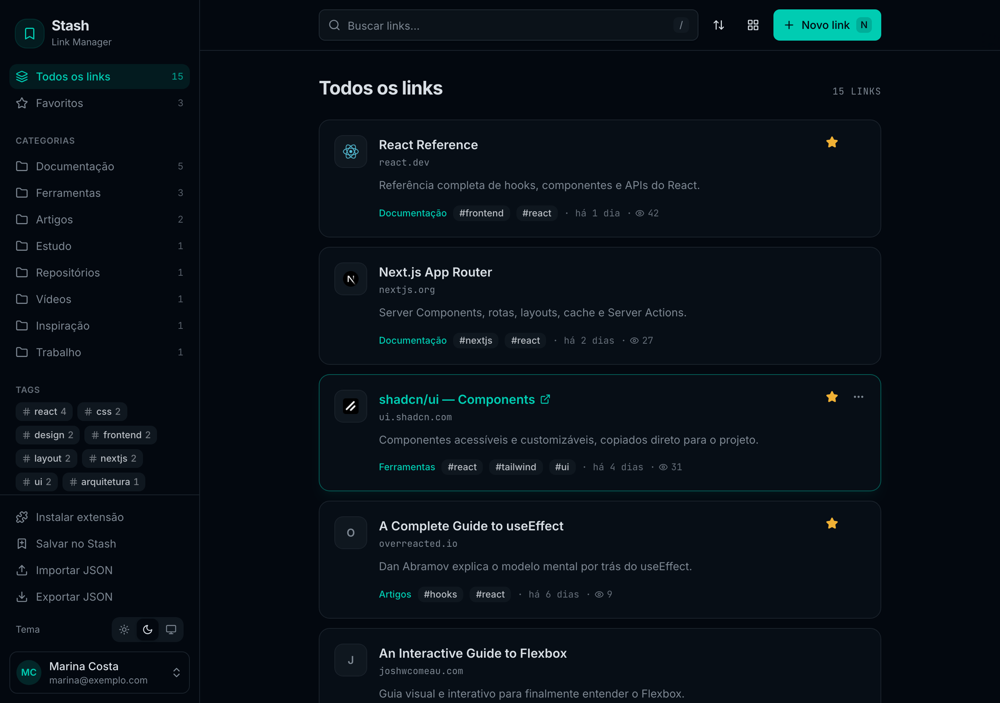
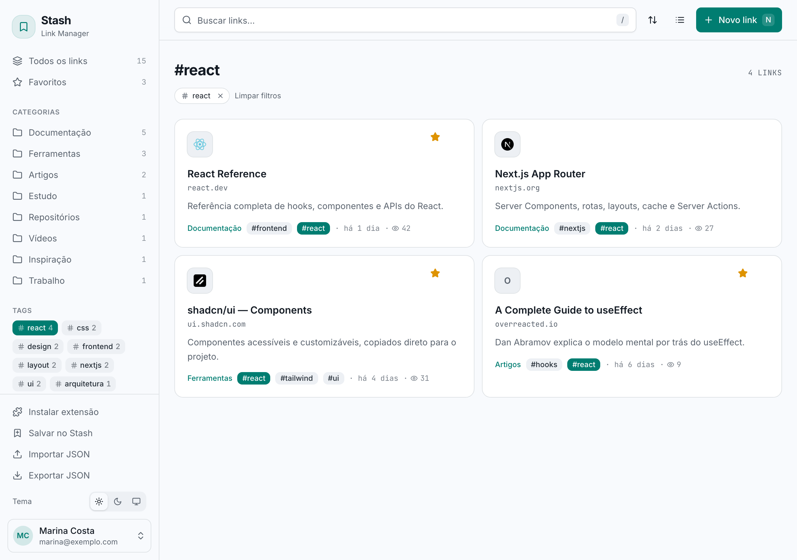
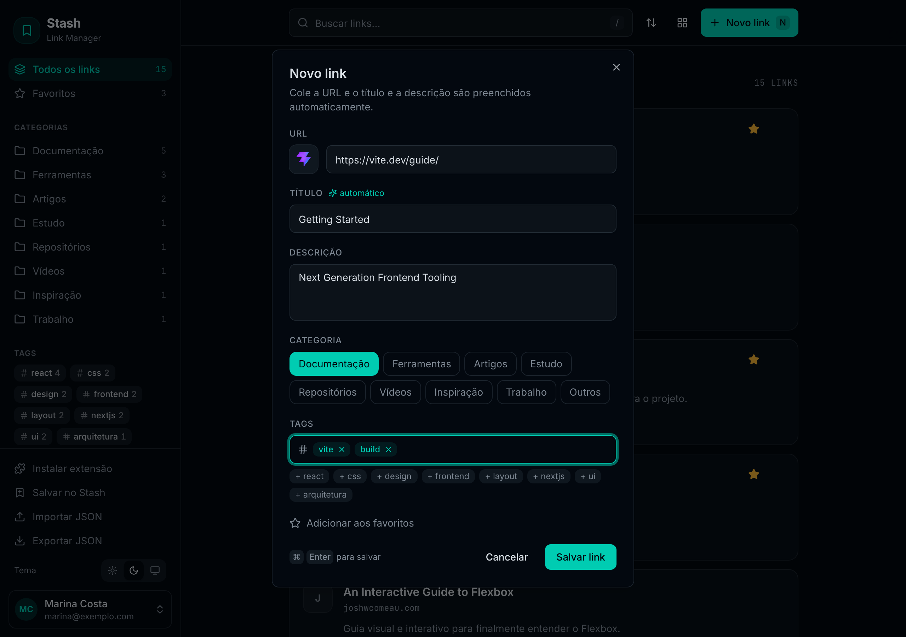
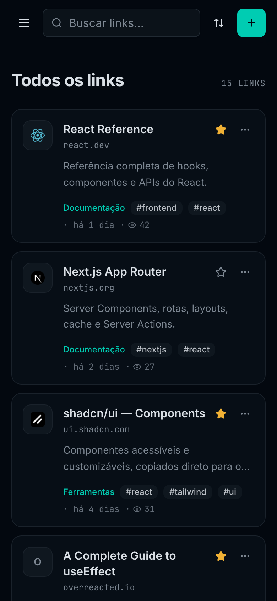
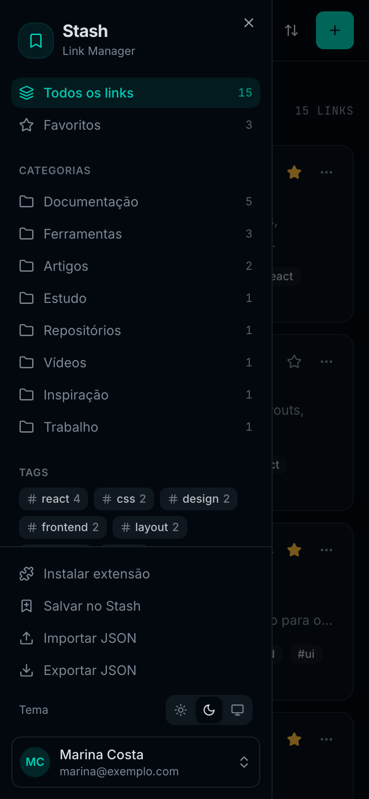
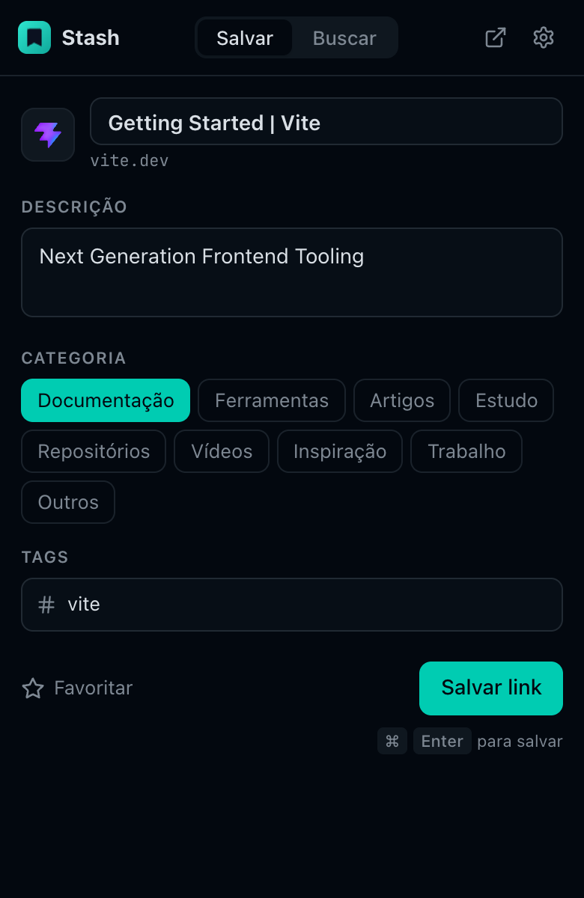
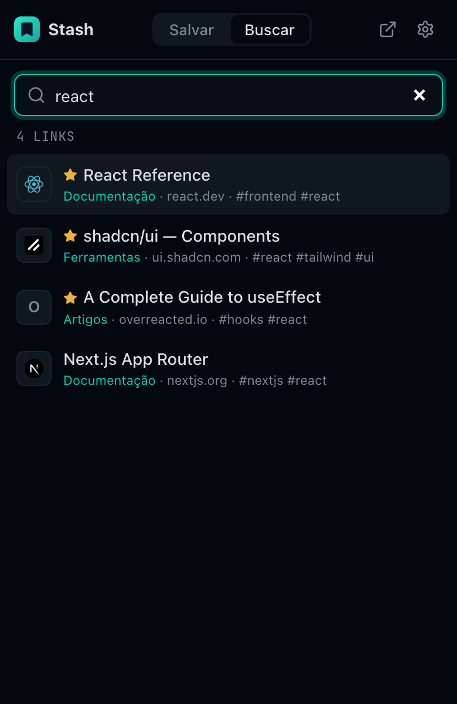
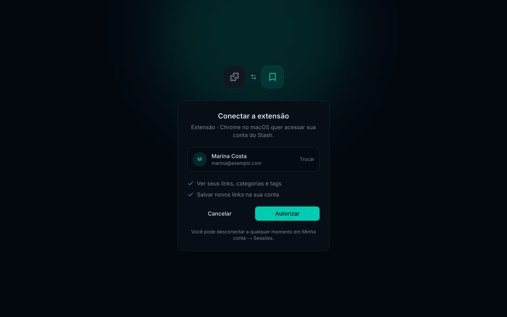

# Stash

Gerenciador pessoal de links: documentações, ferramentas, posts e qualquer coisa que valha guardar, tudo em um só lugar.



<table>
  <tr>
    <td width="50%"></td>
    <td width="50%"></td>
  </tr>
  <tr>
    <td align="center"><sub>Tema claro, visualização em grade e filtro por tag</sub></td>
    <td align="center"><sub>Cole a URL: título, descrição e ícone vêm sozinhos</sub></td>
  </tr>
</table>

<p align="center">
  
  &nbsp;&nbsp;
  
</p>

## Rodando localmente

```bash
pnpm install
cp .env.example .env.local
pnpm dev                        # http://localhost:3000
```

Sem as variáveis do Turso, o app usa um banco local em `data/stash.db` (fora do git), então não precisa de conta no Turso para desenvolver.

## Contas

O cadastro é aberto: qualquer pessoa pode criar uma conta e cada uma vê só os próprios links. Para fechar a criação de novas contas (por exemplo, se aparecer abuso), defina `ALLOW_SIGNUP=false`; quem já tem conta continua entrando normalmente.

Cada usuário tem seus próprios links, categorias e tags. Em **Minha conta** (menu do usuário na barra lateral) dá para editar nome/e-mail, trocar a senha e ver/revogar sessões e extensões conectadas. Trocar a senha encerra todas as outras sessões. As sessões ficam no banco (só o hash do token é guardado) e duram 7 dias por padrão (`AUTH_SESSION_MINUTES`).

## Banco de dados

O app usa [Turso](https://turso.tech) (libSQL, compatível com SQLite) via `@libsql/client`. O schema é criado e atualizado sozinho por migrações versionadas em [`lib/db.ts`](lib/db.ts) (tabela `schema_migrations`). Para mudar o schema, **adicione uma migração nova no fim da lista**; nunca edite uma que já foi aplicada.

## Deploy na Vercel

1. Crie o banco no Turso:
   ```bash
   turso db create stash
   turso db show stash --url        # → TURSO_DATABASE_URL
   turso db tokens create stash     # → TURSO_AUTH_TOKEN
   ```
2. Importe o repositório na Vercel (detecta Next.js e pnpm sozinha).
3. Em **Settings → Environment Variables**, defina:
   - `TURSO_DATABASE_URL` e `TURSO_AUTH_TOKEN`
   - `APP_URL` com o domínio final (ex.: `https://stash.seudominio.com`). Se ficar vazio, usa o domínio de produção da Vercel.
4. Faça o deploy, abra o site e crie sua conta.

Sem `TURSO_DATABASE_URL`, o app recusa iniciar na Vercel (o disco de lá é temporário e os dados seriam perdidos). Para backup, o Turso tem *point-in-time recovery*; o **Exportar JSON** da barra lateral exporta os links de cada usuário.

## Screenshots

As imagens deste README são geradas com:

```bash
pnpm screenshots
```

O comando faz o build, sobe o app com um banco **temporário** (ignora o `.env` e o Turso, então nada vai para o seu banco), cria a conta de demonstração com os links de [`scripts/demo-links.json`](scripts/demo-links.json), instala a extensão baixada pelo próprio app e salva as imagens em `docs/screenshots/`. Precisa de internet (favicons e títulos das páginas) e do Chromium do Playwright; se ele não estiver instalado, rode `pnpm exec playwright install chromium`.

## Funcionalidades

- Adicionar, editar, excluir (com **desfazer**) e favoritar links
- Título, descrição e favicon preenchidos automaticamente a partir da URL (exceto endereços de rede interna, como `http://10.0.0.5` ou `http://intranet`: o servidor não acessa redes internas, então o título é preenchido à mão ou pela extensão, que lê direto da página)
- Aviso de link duplicado
- Busca por título, URL, descrição, categoria e tags (sem diferenciar acentos)
- Filtros por categoria, tag e favoritos, com contadores na barra lateral
- Ordenação (recentes, antigos, A–Z, mais acessados) e visualização em lista ou grade
- Contador de acessos por link
- Importar/exportar JSON
- Bookmarklet **"Salvar no Stash"**: arraste da barra lateral para os favoritos do navegador e salve qualquer página com um clique
- Tema claro, escuro ou do sistema
- Atalhos: <kbd>/</kbd> ou <kbd>⌘K</kbd> busca · <kbd>N</kbd> novo link · <kbd>⌘ Enter</kbd> salva · <kbd>Esc</kbd> limpa a busca

## Extensão do navegador

A pasta [`extension/`](extension/) tem uma extensão (Manifest V3) para Chrome, Edge, Brave e Arc:

- **Popup** (clique no ícone ou <kbd>Alt+Shift+S</kbd>): salva a aba atual com título e descrição já preenchidos, avisa se o link já existe, e tem uma aba **Buscar** para abrir qualquer link salvo.
- **Clique direito** → "Salvar esta página/link no Stash": salva direto, com a categoria padrão escolhida nas configurações.

<p align="center">
  
  &nbsp;&nbsp;
  
</p>

<p align="center">
  <br />
  <sub>Conectar a extensão é só autorizar, sem digitar senha nela</sub>
</p>

### Instalação

No Stash, clique em **Instalar extensão** na barra lateral (página `/extensao`): lá tem o download do `.zip` e o passo a passo. Resumindo:

1. Baixe e descompacte o `.zip`
2. Em `chrome://extensions`, ative o **Modo do desenvolvedor** e clique em **Carregar sem compactação**
3. A extensão abre sozinha a tela de autorização: clique em **Autorizar**

O `.zip` já vem configurado com o endereço do servidor (`APP_URL`), gravado em `config.js` no momento do download. Carregando a pasta `extension/` direto do repositório, a extensão aponta para `http://localhost:3000`.

Nenhuma senha fica na extensão: a autorização gera um token válido por 1 ano, devolvido direto para a extensão. Ele aparece em **Minha conta → Sessões** e pode ser revogado por lá ou pelo "Desconectar" da extensão. Entrar com e-mail e senha na própria extensão continua disponível como alternativa.

#### Como funciona a conexão

A extensão abre `/connect?redirect=<página da extensão>&state=<aleatório>`. Ao autorizar, o Stash cria o token e redireciona para `chrome-extension://…/connected.html#token=…&state=…`. A página confere se o `state` é o mesmo que ela gerou (e se o pedido tem menos de 15 minutos) antes de salvar. O servidor só aceita redirecionar para a página `connected.html` de uma extensão, nunca para um site.

### API

| Método | Rota | Descrição |
| --- | --- | --- |
| `GET` | `/api/v1/ping` | `{ app: "stash" }`, usado para validar o endereço |
| `POST` | `/api/v1/token` | `{ email, password, label? }` → `{ token, expiresAt, user }` |
| `DELETE` | `/api/v1/token` | Revoga o token enviado |
| `GET` | `/api/v1/links` | `{ links, categories, tags, user }` do dono do token |
| `POST` | `/api/v1/links` | Cria um link. Com `autoMeta: true`, busca título/descrição na página. `409` se já existir |

Autenticação: `Authorization: Bearer <token>`.
